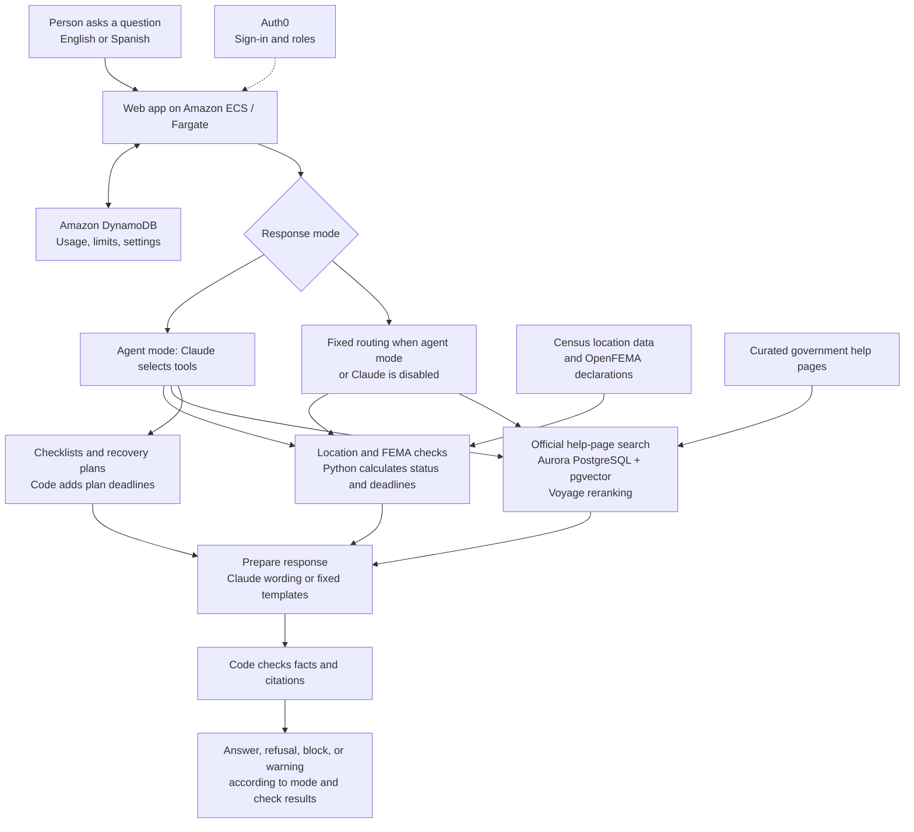

# Disaster Aid Navigator

**Plain-language disaster recovery guidance, with FEMA application deadlines calculated in code and answers checked against their sources.**

Disaster Aid Navigator helps people answer a stressful question:

> “Can my household apply for FEMA disaster help, and by when?”

It combines public disaster data from 44 sources, official recovery guidance, and conversational AI in English and Spanish. The engineering principle is simple: **code calculates the facts; AI explains them; code checks the response.** It also helps people work through follow-up questions and build a sourced recovery plan.

44 Sources: FEMA 10, USDA 9, IRS 6, SBA 5, HHS 4, DOL 2, ED 2, SAMHSA 2, HUD 2, VA 2

Live Sources: 
1. Census Geocoder
2. Census ZCTA
3. OpenFEMA DisasterDeclarationsSummaries

> This is an independent guidance tool, not a FEMA eligibility decision or a guarantee of assistance. Confirm application requirements and deadlines with [DisasterAssistance.gov](https://www.disasterassistance.gov). It is not endorsed by FEMA.

## Why this matters

FEMA’s disaster data is public, but interpreting it requires care. A county declaration may cover assistance to local governments without opening assistance to households. Deadlines can change, place names can be ambiguous, and denial letters can leave people unsure what to do next. A misunderstood deadline can mean missing an opportunity to apply.

The problem statement in **https://www.edgewithais.com** frames this as a practical access problem: turn raw disaster information into guidance a family can understand and act on. The Navigator aims to reduce that interpretation burden while keeping important decisions tied to government data and published guidance.

The business value is clearer next steps and less effort navigating fragmented information. The measurements below assess technical performance and operating cost; they do **not** establish improved aid approval rates or real-world household outcomes.

## What people can do

| Need | Navigator response |
|---|---|
| Check a location | Resolves a county, parish, ZIP code, or street address and checks FEMA Individual Assistance status and available application deadlines. Asks for clarification when a ZIP spans counties. |
| Understand recovery options | Answers questions using official help pages from FEMA, SBA, IRS, USDA, HUD, and other agencies, with numbered sources and available update dates. |
| Get help in Spanish | Supports Spanish questions and answers with the same date-checking approach. |
| Work out next steps | Provides fixed checklists and appeal guidance; agent mode adds follow-up intake and sourced recovery plans. |
| Ask a combined question | Agent mode can combine a location-specific deadline check with general recovery guidance in one reply and show “How I checked” steps. |

The web app includes Auth0 sign-in, standard and administrator roles, daily usage limits, and an administration dashboard for usage, tokens, and cost.

**Scope matters:** a location’s Individual Assistance status and application window help establish whether applying may be possible. They do not determine whether a particular household will qualify or receive funding.

## Architecture: from question to checked guidance

Agent mode chooses from tools backed by the same FEMA and help-page pipelines used by fixed routing. Administrators can disable agent mode; fixed routing is also the fallback when Claude is disabled.

### What each technology contributes

| Technology | Role and reason for use |
|---|---|
| **Python** | Resolves locations, interprets FEMA records, distinguishes household assistance from government-only assistance, and calculates deadlines and days remaining. Keeps date arithmetic outside the language model. |
| **OpenFEMA and Census data** | Supply disaster declarations and location information used by the deadline pipeline. Missing dates, duplicate records, and ambiguous locations require explicit handling. |
| **Claude via the Anthropic API** | Explains tool results, selects tools in agent mode, and drafts sourced recovery guidance. The source README identifies Haiku 5.5 as the application model. |
| **Amazon ECS Express Mode on AWS Fargate** | Runs the containerized web app with managed compute, HTTPS, load balancing, health checks, and deployment support. |
| **Amazon Aurora PostgreSQL Serverless v2 + pgvector** | Stores curated help-page passages and supports keyword and meaning-based search. The documented corpus contains 76 passages from 44 official pages in English and Spanish. |
| **Voyage embeddings and reranking** | Support meaning-based retrieval and reorder search results so the most relevant passages reach the answer generator. |
| **Amazon DynamoDB** | Shares usage counts, daily limits, and settings across app instances. The source reports a 180-day expiry for usage records. |
| **Auth0** | Part of Okta it provides user sign-in and standard/admin roles. |
| **AWS Secrets Manager and IAM database authentication** | Manage application secrets and use short-lived database access tokens rather than a stored database password. |
| **Docker and offline continuous integration** | Package the app and check behavior using automated tests without depending on live external services. |

## Safety guardrails and failure behavior

The design reduces opportunities for unsupported answers, but its checks are not a guarantee that every answer is correct.

- **Calculated deadline facts.** Python computes application status, dates, and days remaining. Checks compare response dates, disaster codes, and day counts with those results.
- **Source-limited recovery guidance.** Search uses curated government pages. Weak matches can be refused before an AI call; generated answers are checked for citations, numbers, and web addresses. Citation checks do not prove that every sentence fully reflects its source.
- **Structured plans.** Each plan step must reference a source or declaration. Code inserts deadline dates, and plan validation rejects specified errors such as missing sources or skipped open deadlines.
- **Bounded agent behavior.** Agent mode allows up to eight model calls per message. Recent conversation and situation fields are treated as hints; facts are looked up again, and unsupported situation fields are dropped.
- **Fixed guidance for sensitive steps.** Checklists and appeal help use predefined content rather than improvised legal steps.

### A failed check does not have the same outcome in every mode

| Path | Documented behavior |
|---|---|
| Fixed-route FEMA explanation | A response that drifts from calculated facts is blocked. Fixed templates can avoid an AI call. |
| General help-page answers | Weak retrieval matches can be refused; answers undergo citation and factual-value checks. The evaluation still found out-of-scope misses. |
| Agent response | A failed fact check triggers one rewrite with the detected problems. **If the second check also fails, the response is shown with a warning.** |

Agent mode’s warning behavior is an important limitation: a displayed answer is not necessarily a passed answer. The reported live agent evaluation found no displayed answers failing its fact check, but that result does not remove the warning path from the product.

## Reported results, with context

| Evaluation | Reported result | What it establishes—and its limit |
|---|---|---|
| Deadline scenarios | **15/15** correct status and deadlines; **5/15** required no AI call | Strong results on a small adversarial set. Template grounding was reported at 100%; deliberately incorrect grounding-test answers were caught. This is not a live-model accuracy estimate. |
| General recovery questions | **51/52 answerable questions** answered correctly with an appropriate source cited | Part of a 58-question English/Spanish set, including 10 held-back questions. Citation checks passed for all evaluated answers, while only **5/6** off-topic questions were refused. |
| Retrieval | Correct source first: **95%**, or **94% including held-back questions**; top three: **100%** | Measures source retrieval on the project’s evaluation set. |
| Live agent evaluation | **97% tuning**, **88% held-back** | A 40-case evaluation, run twice per case, using code checks and a model-based plan judge. No displayed answer failed the fact check in those runs. |
| Response time | **5.2 seconds median** for general answers | A measured median, not a latency commitment. A paused database can add startup delay. |

Known misses include a mortgage question that should have been refused and two questions that alternated between answering and refusing across runs. Agent coverage also includes 56 offline tests and 15 grader tests; scripted model behavior in those tests is distinct from the live evaluation.

## What this project demonstrates

Disaster Aid Navigator brings together business problem framing, AWS application delivery, data processing, retrieval, and agent orchestration. Its central engineering choice is to assign calculations and structured rules to code, then use AI for explanation and guided interaction.

The evaluations, disclosed misses, and explicit failure paths make the design easier to assess. The next challenge is improving coverage and reliability as government guidance changes.

## Next priorities

- Address remaining out-of-scope answers and inconsistent refusals.
- Refresh official help-page content on a schedule.
- Reconcile FEMA extension notices when OpenFEMA data lags.
- Publish live-model deadline results alongside the template baseline.
- Move model access to Amazon Bedrock when the required model is available to the account.
- Extend guidance to SBA loan deadlines, situation-specific document preparation, and potential call-center workflows.

These are planned improvements, not current capabilities or commitments.

## Explore the implementation

Interested in live demo? [Reach out to me: ](https://edgewithais.com/contact/?your-interest=Live%20demo%20of%20Disaster%20Aid%20Navigator) 

The deadline pipeline uses [OpenFEMA Disaster Declarations Summaries v2](https://www.fema.gov/openfema-data-page/disaster-declarations-summaries-v2). Recovery guidance draws on curated public government help pages. Data availability, publication delays, and content freshness can affect the guidance provided; confirm important application decisions with the relevant agency.
