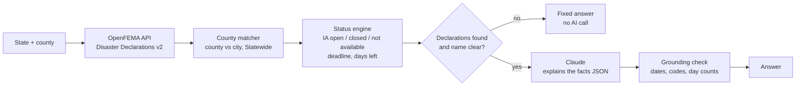

# 🌪️ Disaster Aid Navigator

**"Can my household get FEMA disaster aid, and by when do I have to apply?"**

Enter a state and county. The app checks FEMA's official disaster declarations and answers in plain English: whether households can apply for FEMA Individual Assistance right now, the exact deadline, and how many days are left.

```
$ python3 -m disaster_aid.cli MO "St. Louis County"

Yes. Families in St. Louis County can apply for FEMA help now.

Severe storms, straight-line winds, and tornadoes in Missouri (DR-9901-MO)
This happened from September 14, 2026 to September 16, 2026.
FEMA declared a major disaster on October 1, 2026.
You can apply until November 30, 2026. You have 27 days left.

  grounding check: PASS
```
*(Example from the synthetic test fixtures.)*

## Why this exists

FEMA publishes declaration data through a free public API, refreshed about every 20 minutes. But it's raw data: county codes, program flags and filing dates spread across rows. A resident whose home just flooded needs one answer: **can I apply, and by when?** The rules are easy to misread:

- A county can be declared but **only for Public Assistance**, which pays local governments, not households.
- Missouri has a **St. Louis County and a separate St. Louis City**. They're often in the same declaration with different programs.
- Deadlines are often **extended**, and sometimes no filing date is published yet.

A wrong deadline can cost someone their aid, so this project is built around one rule: **code computes the facts, the AI only explains them, and code checks the explanation.**

## How it works



| Step | File | What it does |
|---|---|---|
| Fetch | `disaster_aid/fema_client.py` | Queries OpenFEMA by FIPS state code and date window, only the 18 fields needed, with paging. No API key. |
| Match | `disaster_aid/geo.py` | Maps "Saint Louis city" to `St. Louis (Independent City)`. Asks the user to choose when a name is ambiguous. Includes statewide declarations. |
| Decide | `disaster_aid/status.py` | Merges duplicate rows, applies FEMA's rule that Individual Assistance = `ihProgramDeclared` or `iaProgramDeclared`, uses `lastIAFilingDate` for the deadline, and estimates FEMA's usual 60-day window, clearly flagged, when no date is published. |
| Explain | `disaster_aid/explainer.py` | Claude rewrites the facts in plain English, 120 words max. An offline template does the same without an API key. |
| Verify | `disaster_aid/grounding.py` | Every date, declaration code and "N days" count in the answer must appear in the facts. Open deadlines must be stated, and estimates must be called estimates. |

## Results (offline baseline)

15 scenarios built to break things: open, closed and estimated deadlines, county vs independent city, parishes, statewide declarations, duplicate rows, old disasters, a county that doesn't exist.

| Metric | Template baseline | Claude |
|---|---|---|
| Status accuracy | **100%** | same engine |
| Grounded answers | **100%** | *run `python3 evals/run_evals.py`* |
| Answers within 130 words | **100%** | |
| AI calls needed | 0 of 15 | 10 of 15 (5 answered by rules) |

The grounding checker has its own tests that feed it **deliberately wrong answers**: a shifted deadline, an invented disaster number, a wrong day count, a missing deadline, an unflagged estimate. It must catch every one.

## Cost

Each AI call sends about 1,100 characters of facts, a few hundred tokens, and gets back a short answer. Counties with no declarations, or with an ambiguous name, get a rule-based answer with **no AI call**. A full eval run costs a few cents.

## Run it

Python 3.10+ and no required packages.

```bash
# Offline: synthetic fixtures, no network, no key
python3 -m disaster_aid.cli MO "St. Louis County" --offline --fixtures fixtures/declarations.json --as-of 2026-11-03

# Live FEMA data, template answer
python3 -m disaster_aid.cli TX "Harris County" --offline

# Live FEMA data, Claude answer
export ANTHROPIC_API_KEY="sk-ant-..."
python3 -m disaster_aid.cli TX "Harris County"

# ZIP code or street address instead of a county (free U.S. Census data, no key)
python3 -m disaster_aid.cli --place 77002 --offline
python3 -m disaster_aid.cli --place "1001 Avenida de las Americas, Houston, TX 77010" --offline

# Spanish answer, plus the "what to do next" checklist
python3 -m disaster_aid.cli TX "Harris County" --offline --lang es --steps

# How to appeal a FEMA "no" letter (add --lang es for Spanish)
python3 -m disaster_aid.cli --denied

# Web page, same as the offline command above: live FEMA data, template answer
python3 -m disaster_aid.web

# Tests and evals
python3 -m pytest -q
python3 evals/run_evals.py --offline
python3 evals/run_evals.py           # with Claude
```

On macOS, if you see `CERTIFICATE_VERIFY_FAILED`, run `python3 -m pip install --user certifi`.

## Design trade-offs

- **Deterministic core, AI at the edge.** Deadlines and eligibility are computed in code that's 100% testable. The model never does date arithmetic.
- **Verify, don't trust.** The grounding check runs on every answer, including in the CLI, so a made-up date is caught right away.
- **County first, even for ZIP codes.** FEMA declares counties, and ZIP codes cross county lines. A ZIP code is turned into counties with the Census 2020 ZIP-to-county file (downloaded once, about 7 MB, cached in `~/.cache/disaster-aid-navigator`). If it covers more than one county, the app lists them and asks. A street address goes to the Census Geocoder, which returns one county. Neither is saved.
- **Spanish uses the same fact check.** Spanish answers keep dates and codes exact ("30 de noviembre de 2026"), and the grounding check reads Spanish dates and "días", so a wrong deadline is caught in either language.
- **Fixed help text.** The "what to do next" checklist and the appeal help are written in code, not by the AI. They hold no disaster-specific dates, so there is nothing for a model to get wrong.
- **Synthetic fixtures.** Tests and CI never hit the network, so results are reproducible. `fixtures/README.md` explains each edge case.
- **No dependencies.** The Python standard library only, so the whole pipeline can be read and debugged.

## Limitations

- **Not an official FEMA tool.** Always confirm at [DisasterAssistance.gov](https://www.disasterassistance.gov) or 1-800-621-3362.
- **Extensions:** whether `lastIAFilingDate` is updated when FEMA extends a deadline still needs checking against FEMA press releases (see Roadmap).
- Tribal Nations are listed under their state in this dataset.

## Roadmap

- [ ] Validate `lastIAFilingDate` against FEMA deadline-extension press releases
- [ ] Run the Claude evals and fill in the results table
- [x] Spanish answers (FEMA serves many Spanish-speaking survivors)
- [x] Search by ZIP code or street address
- [x] "What to do next" checklist and help after a FEMA denial
- [x] Simple web page with a state/county picker (`python3 -m disaster_aid.web`)
- [ ] SBA disaster loan deadlines alongside FEMA's

---

Data: [OpenFEMA Disaster Declarations Summaries v2](https://www.fema.gov/openfema-data-page/disaster-declarations-summaries-v2). This product uses the FEMA OpenFEMA API but is not endorsed by FEMA or the Federal Government.
